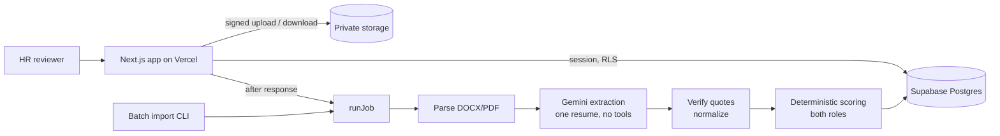

# Resume Intelligence

Evidence-first resume screening for an HR team reviewing 47 anonymized resumes against two very different roles: an **LCA (Life Cycle Assessment) Consultant** and a **UI/UX Design Intern** at Growth For Impact.

A language model reads each resume and quotes it; deterministic, versioned code scores it. Every point on screen traces to a verbatim passage that was found in the source document, every record (including the one that could not be read) is accounted for, and people make the decisions.

## What it does

- **Two independent rankings.** Each candidate is assessed separately for both roles under versioned 9-criterion rubrics, then routed (stronger for LCA, stronger for UI/UX, both, neither evidenced, uncertain). Labels route attention; nothing rejects.
- **Explainable scores.** Points = weight × evidence state (Direct 1, Related 0.5, Not evidenced 0, Uncertain 0 + review flag). The candidate page shows each criterion's quotes linked to the highlighted passage in the extracted text, beside a one-click signed download of the original.
- **AI output cleaned by code.** Schema validation, quote verification against the source, tool-alias canonicalisation (OpenLCA never counts as GaBi/SimaPro), month-precise overlap-merged experience, skills-list keyword capping, prompt-injection flagging. Raw model output is kept beside the cleaned profile.
- **Data integrity in the database.** Composite foreign keys make cross-candidate assignment structurally impossible; SHA-256 dedupe, idempotent jobs with atomic leases, one transaction per result, immutable assessment and ranking history.
- **Live upload.** A new DOCX or text PDF goes through the identical pipeline and both rankings refresh.
- **Private by default.** Supabase Auth, RLS on every table, private storage with 60-second signed URLs, service-role key server-only, logs without resume text.

## Architecture



Modular monolith: domain logic in `packages/` has no framework imports and is shared by the web app and the CLI.

```text
app/                 Next.js routes (dashboard, roles, candidates, uploads, methodology, API)
components/          UI, grouped by area
packages/
  domain/            types, rubrics (single source of truth), errors, versions
  schemas/           Zod contract for model output
  parsers/           content-sniffed DOCX and PDF adapters with locators
  normalization/     text, sections, tool aliases, dates, profile builder
  extraction/        versioned prompt, Gemini adapter, quote verifier
  scoring/           experience intervals, criterion guards, scores, routing, ranking, quality
  workflows/         the one analysis path used by batch and upload
lib/                 Supabase clients, auth, pipeline runner, read queries, logging
supabase/migrations/ schema, RLS + functions, rubric seed
scripts/             dataset inspection, batch import, reports, admin
tests/               unit + integration (synthetic fixtures only)
docs/                specs and implementation records
```

## Run locally

```bash
npm install
cp .env.example .env.local      # fill the Supabase and Gemini values
npm test                        # unit + integration tests
npm run inspect:dataset         # WF-01: inspect the dataset folder
npm run import:batch            # import and score the 47 resumes
npm run admin:create-user -- you@example.com HR_REVIEWER
npm run dev                     # http://localhost:3000
```

## Documentation

| Document | Contents |
|---|---|
| [docs/spec/](docs/spec/) | The eight build specifications and the planning summary |
| [METHODOLOGY](docs/METHODOLOGY.md) | Extraction, cleaning, scoring, routing and ranking rules |
| [ARCHITECTURE_DECISIONS](docs/ARCHITECTURE_DECISIONS.md) | Decisions made during implementation, with evidence |
| [DATA_DICTIONARY](docs/DATA_DICTIONARY.md) | Tables, integrity rules, functions |
| [IMPORT_MANIFEST](docs/IMPORT_MANIFEST.md) · [SEGMENTATION_REPORT](docs/SEGMENTATION_REPORT.md) | What the dataset actually contained |
| [DATA_QUALITY_REPORT](docs/DATA_QUALITY_REPORT.md) · [QA_REPORT](docs/QA_REPORT.md) | Results of the real import and the test suite |
| [KNOWN_LIMITATIONS](docs/KNOWN_LIMITATIONS.md) | What the system does not do, and the mitigations |
| [DEPLOYMENT_GUIDE](docs/DEPLOYMENT_GUIDE.md) | Supabase, environment, accounts, Vercel |

Resume files are restricted data and are never committed.
