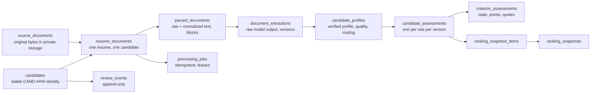

# Data Dictionary

Source of truth: `supabase/migrations/`. Every table has RLS enabled; HR users read through `is_hr()` policies and never write directly.

## Layers

## Tables

| Table | Key columns | Integrity rules |
|---|---|---|
| `jobs` | `job_key`, `jd_version`, `title`, `description` | unique (`job_key`, `jd_version`) |
| `job_criteria` | `rubric_version`, `criterion_key`, `weight`, `evidence_guidance` | unique per job+rubric+key; weight ≥ 0; totals validated in code and by the seed drift test |
| `source_documents` | `source_kind`, `storage_path`, `sha256`, `byte_size`, `upload_status` | `sha256` unique (byte-identical duplicates impossible); size ≤ 5 MB; storage path is a UUID |
| `candidates` | `candidate_ref` (CAND-0001…), `review_status` | ref from a sequence, never from a filename or rank |
| `resume_documents` | `candidate_id`, `source_document_id`, `source_record_key`, `processing_status` | `source_record_key` non-null unique; (`id`,`candidate_id`) unique for composite FKs |
| `parsed_documents` | `raw_text`, `normalized_text`, `blocks` (with locators), `content_fingerprint` | unique (`resume_id`, `parser_version`) |
| `processing_jobs` | `idempotency_key`, `status`, `attempt_count`, `lease_*`, `last_error_code` | key unique = SHA-256(resume, sha256, all component versions) |
| `document_extractions` | `model_*`, `prompt_version`, `schema_version`, `raw_model_output` | unique (`resume_id`, `extraction_version`) |
| `candidate_profiles` | `normalized_profile`, `extraction_quality`, `classification`, `is_current` | FK (`resume_id`,`candidate_id`) → resume; one current profile per resume (partial unique index) |
| `candidate_assessments` | `score`, `score_band`, versions, `mandatory`, `review_flags`, `primary_points` | FK (`profile_id`,`candidate_id`,`resume_id`) → profile; unique per profile+job+JD+rubric+scoring version; 0 ≤ score ≤ 100 |
| `criterion_assessments` | `evidence_state`, `multiplier`, `points_awarded`, `evidence`, `explanation` | FK (`assessment_id`,`job_id`) and (`criterion_id`,`job_id`): criterion must belong to the assessment's job; `points = weight × multiplier` check |
| `ranking_snapshots` / `_items` | `snapshot_version`, `rank_position`, `tie_break` | item FK (`assessment_id`,`candidate_id`,`job_id`): an item cannot point at another job's assessment; unique rank and candidate per snapshot |
| `review_events` | `event_type`, `previous_value`, `new_value`, `notes`, `idempotency_key` | append-only (no client update/delete); written only via `record_review` |
| `audit_logs` | `event_type`, `resource_*`, `correlation_id`, `metadata` | no resume text; admin-readable only |
| `app_users` | `user_id`, `role` (ADMIN, HR_REVIEWER) | roles resolved server-side |

## Functions

| Function | Caller | Purpose |
|---|---|---|
| `is_hr()`, `is_admin()` | RLS policies | role check for `auth.uid()` |
| `record_review(...)` | HR (authenticated) | idempotent status change / note, audited |
| `claim_processing_job(id, owner, lease)` | service role | atomic lease with `FOR UPDATE SKIP LOCKED` |
| `persist_assessment_bundle(jsonb)` | service role | extraction + profile + both assessments + criteria in one transaction; idempotent |
| `save_ranking_snapshot(...)` | service role | advisory-locked snapshot version and items |

## Enumerations

Processing status, evidence state, experience type, relevance tag, classification and review status are listed in [packages/domain/types.ts](../packages/domain/types.ts) and enforced by `check` constraints. Error codes and their HR messages: [packages/domain/errors.ts](../packages/domain/errors.ts).
