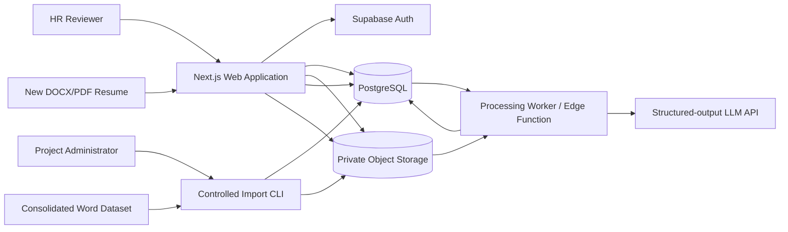
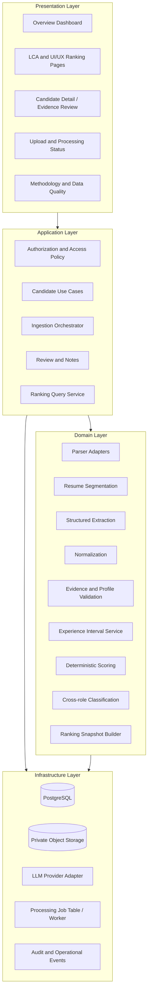
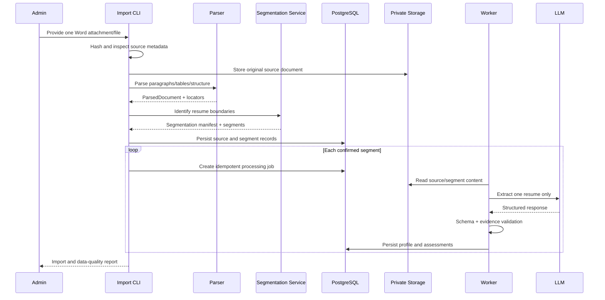
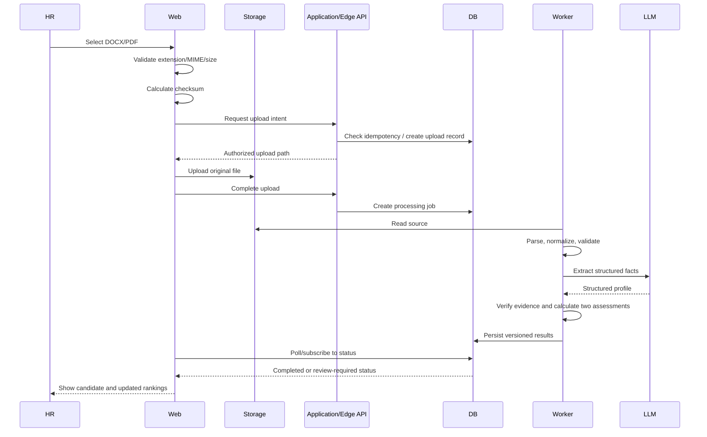

# HLD — High-Level Design

> **Document role:** System architecture and major design decisions.  
> **Audience:** Software architect, engineering team, AI implementation agent, technical reviewer.  
> **Status:** Approved target architecture for V1, subject to validation against the actual repository and service constraints.

---

## 1. Architectural summary

The Resume Intelligence Platform is a small, auditable recruitment decision-support application. It accepts an initial consolidated Word document containing the resume dataset and later individual DOCX/PDF uploads. It preserves original source material, extracts structured evidence, validates it, calculates separate LCA and UI/UX assessments, and exposes rankings to authorized HR reviewers.

The recommended architecture is a **modular monolith with managed data services and an independently executable ingestion worker/CLI**. This gives the project clear domain boundaries without unnecessary microservices.

### 1.1 Recommended stack

| Layer | Preferred technology | Responsibility |
|---|---|---|
| Web application | Next.js + TypeScript | HR UI, routing, authenticated interaction |
| UI system | Tailwind CSS + shadcn/ui or equivalent | Consistent, responsive components |
| Database | Supabase PostgreSQL | Relational records, constraints, transactions, assessments |
| Object storage | Supabase Storage private bucket | Source documents and protected artifacts |
| Authentication | Supabase Auth | HR-only access and session management |
| DOCX parser | Mammoth.js plus a structural inspection adapter | Text extraction and paragraph/table handling |
| PDF parser | PDF.js | Text-based PDF extraction with page provenance |
| Runtime schemas | Zod | Validation at boundaries and typed contracts |
| AI extraction | Structured-output-capable LLM API | Evidence-grounded field extraction only |
| Scoring | Deterministic TypeScript domain module | Role-specific score calculation and ranking |
| Web deployment | Vercel | Next.js application hosting, subject to plan suitability |
| Import tooling | Node.js CLI using shared parser/domain packages | Initial composite-DOCX import and controlled batch processing |
| UI tests | Playwright | End-to-end browser testing |
| Unit/integration tests | Vitest or project-standard equivalent | Business logic and adapter tests |

The stack is a recommendation, not a reason to ignore an existing repository that already has a viable equivalent. Any substitution must be recorded in `docs/ARCHITECTURE_DECISIONS.md` and preserve the contracts described in `LLD.md`.

## 2. Architectural drivers

The most important drivers are:

1. **Source traceability:** Every candidate claim must map to the actual source document and, where possible, a page/paragraph/table locator.
2. **Data integrity:** Candidate, resume, extraction and assessment records must never be cross-assigned.
3. **Extraction uncertainty:** Parsing and LLM extraction are imperfect; failures and ambiguity must be explicit.
4. **Explainable ranking:** Scores are deterministic calculations from versioned criteria and evidence states.
5. **Two independent roles:** The LCA and UI/UX criteria and rankings must remain separate.
6. **Single-Word-file delivery:** Initial inputs may be a consolidated Word document, not a ZIP or filesystem directory.
7. **New-upload parity:** An individual resume must use the same canonical downstream pipeline as a segment from the batch document.
8. **HR usability:** A non-technical user must be able to interpret results and inspect original material.
9. **Privacy/security:** Resume content is sensitive personal data even when filenames are anonymized.
10. **Future extensibility:** The architecture should accommodate additional roles, parsers and workers without requiring a complete rewrite.

## 3. Architecture principles

- Use a modular monolith for the application and domain logic.
- Keep UI components separate from business rules.
- Keep external provider clients behind adapters.
- Keep the canonical candidate profile independent of any specific LLM provider.
- Treat raw source documents and raw extracted text as immutable evidence.
- Store normalized profiles and assessments as versioned derived data.
- Use database-level integrity constraints, not only frontend checks.
- Use asynchronous processing for operations that may take longer than a normal UI request.
- Use deterministic processing for score calculations and rank ordering.
- Avoid sending whole-dataset context to an LLM; process each resume segment independently.
- Keep web scraping as an optional future source connector, not part of the resume ranking critical path.

## 4. System context

### 4.1 External actors and systems

- HR/recruiter: reviews rankings and uploads additional resumes.
- Project administrator: imports the initial Word dataset and configures criteria.
- Supabase Auth: authenticates authorized application users.
- Supabase Storage: stores source files privately.
- Supabase PostgreSQL: stores jobs, candidates, documents, profiles, processing records and assessments.
- LLM provider: extracts structured candidate facts from supplied resume text.
- Vercel: hosts the web application.
- Local/controlled Node CLI: performs initial Word-document inspection, segmentation and batch import when appropriate.

### 4.2 Context diagram

## 5. Logical architecture

## 6. Major components and responsibilities

### 6.1 Web application

Responsibilities:

- Authenticate HR users.
- Display dataset health and import status.
- Display independent LCA and UI/UX rankings.
- Provide filters/sorting.
- Display candidate profiles and evidence.
- Provide protected access to source documents.
- Accept individual resumes and show processing status.
- Save reviewer notes/status changes.
- Explain scoring methodology and limitations.

The web application must not contain secret LLM credentials, Supabase service-role credentials or unrestricted storage permissions.

### 6.2 Source document registry

Responsibilities:

- Register an original composite Word document or individual uploaded file.
- Store source metadata, checksum, format, size and access path.
- Track the relationship between source container and resume segments.
- Preserve original filenames where supplied.
- Retain source version and import metadata.

For the initial dataset, the Word document is a source container. It is not automatically a folder and must not be treated as 47 separate filesystem files unless separate file objects actually exist.

### 6.3 Document parser adapters

Adapters convert file bytes into a canonical `ParsedDocument` model.

DOCX parsing should capture paragraphs, tables and structural boundaries where feasible. PDF parsing should capture text by page. Scanned/image-only documents must be marked as requiring OCR/manual review; they must not be treated as successfully text-extracted.

Parser adapters must preserve raw extracted content and return source locators. A parser must report what it did not inspect (for example, unsupported text boxes, embedded OLE files or image-only pages) when it can detect those conditions.

### 6.4 Resume segmentation service

This component exists because the initial 47-resume dataset may arrive in a single Word document.

Responsibilities:

- Identify resume boundaries using explicit filenames, stable headings, delimiters, repeated layout patterns and structural cues.
- Generate distinct resume segments from the source container.
- Track original source range/locator for each segment.
- Calculate segment fingerprints.
- Record segmentation confidence and ambiguity reasons.
- Stop uncertain records from proceeding as confirmed candidates.

Segmentation must never rely only on a forced target count of 47. The expected count is a reconciliation check, not a license to invent boundaries.

### 6.5 Structured extraction service

Input: one normalized resume segment at a time.

Output: a schema-validated structured candidate profile containing facts, evidence references and uncertainty flags.

Responsibilities:

- Invoke the configured LLM provider through an adapter.
- Apply a versioned extraction prompt and schema.
- Parse structured response.
- Reject invalid shapes.
- Verify evidence quotes against source text.
- Store model and prompt version metadata.
- Retry transient errors with a bounded policy.

The extraction service must not compute final role rankings or make employment decisions.

### 6.6 Normalization service

Responsibilities:

- Normalize skill aliases, tool names, dates, degrees and section labels.
- Preserve raw field values.
- Separate direct, related, unverified and uncertain evidence.
- Avoid merging materially distinct tools or standards.
- Retain source evidence for normalized fields.

Examples:

- `Open LCA`, `openLCA` and `OpenLCA software` may map to canonical `OpenLCA`.
- `GaBi`, `SimaPro` and `OpenLCA` must remain distinct tools.
- Environmental monitoring and emissions inventory may be related evidence but must not become a completed LCA project without support.

### 6.7 Experience service

Responsibilities:

- Parse start/end month values.
- Identify current roles.
- Classify experience by job-relevant domain and type.
- Detect and merge overlapping date intervals for duration calculations.
- Keep professional, internship, academic/research and other experience categories distinct.
- Record partial-date assumptions and uncertainty.

Do not simply add all listed role durations. Do not assume every environmental role is LCA experience.

### 6.8 Scoring service

Responsibilities:

- Load versioned role criteria.
- Evaluate criterion evidence states.
- Calculate points with deterministic arithmetic.
- Save criterion-level contributions.
- Produce total scores for both roles.
- Keep missing/uncertain evidence visible.

The service must be pure domain logic where possible: same input profile and criteria version must produce the same score.

### 6.9 Classification and ranking service

Responsibilities:

- Apply configurable cross-role classification thresholds.
- Produce separate ranked lists for each role.
- Apply deterministic tie-breakers.
- Generate a snapshot associated with exact input/profile/JD/scoring versions.

Tie-breakers must be transparent and consistent. Suggested order: higher total score, higher score on role's most critical criterion, fewer unresolved critical evidence flags, then stable candidate reference. Do not use arbitrary database return order.

### 6.10 Review and audit service

Responsibilities:

- Store reviewer status changes and notes.
- Store corrections separately from original extraction.
- Record actor, timestamp, previous value and updated value for sensitive review changes.
- Permit a corrected value to be included in a new normalized profile version without overwriting raw extraction.

### 6.11 Optional public-source connector framework

A future module may collect authorized public LCA benchmarking sources. It must be isolated from candidate scoring and use a source registry, rate limiting, content validation and source provenance. It is not necessary to rank the supplied resumes and is out of scope for V1 implementation.

## 7. Data flow architecture

### 7.1 Initial consolidated Word document

The import CLI may orchestrate parsing and segmentation locally and persist segments/job payloads in controlled batches. If the source attachment is accessed through an application upload, the same steps can be initiated through an authorized admin workflow. The exact execution location must respect file size, runtime and credential constraints.

### 7.2 New individual resume upload

## 8. Deployment topology

### 8.1 Recommended V1 deployment

- **Vercel:** Next.js frontend and lightweight authenticated server endpoints only where suitable.
- **Supabase PostgreSQL:** relational source of truth.
- **Supabase Storage:** private source-document storage.
- **Supabase Auth:** HR authentication.
- **Supabase Edge Functions or controlled worker:** protected orchestration and LLM calls, selected based on runtime limits.
- **Local Node import CLI:** initial composite-DOCX inspection and optional batch import. It uses the same parser/domain packages as the live application.
- **LLM provider:** external API called only from a trusted server/worker environment.

### 8.2 Why the initial batch should not be forced through a Vercel request

A single Word document may contain a large amount of content. Sending it through a serverless request risks payload/runtime constraints and makes retry behaviour harder to control. Store the source file privately, parse it through a controlled importer/worker and persist per-resume jobs. The public web tier should not be responsible for processing all 47 records in one synchronous request.

### 8.3 Plan and data-use verification

Before using a free Vercel plan with actual resume content, verify current plan eligibility, terms, retention/training provisions and the assignment's permitted-use conditions. The project must not assume that a free tier is appropriate for confidential candidate data merely because the frontend can be deployed there. If plan terms are unsuitable, use Vercel only for a synthetic demo or obtain an appropriate project-owned deployment arrangement. Do not send candidate content to a provider without reviewing its data-use and retention terms.

## 9. Trust boundaries

1. Browser to web application: authenticated user input is untrusted.
2. Uploaded document to parser: file bytes are untrusted.
3. Resume text to LLM: document content is untrusted and may contain prompt-injection instructions.
4. LLM output to application: model response is untrusted until schema and evidence validation pass.
5. Web application to database/storage: authorization and RLS must apply.
6. Worker to LLM provider: credentials must remain server-side; outbound payload must be minimized.
7. Admin import CLI to production: import credentials must be controlled and not committed.

## 10. Data architecture overview

Use the relational schema described in `LLD.md`. Major entities:

- `jobs` and `job_criteria` — role descriptions and rubric versions.
- `source_documents` — original composite source document or individual upload.
- `resume_documents` — candidate-specific resume segments/individual file records.
- `candidates` — stable anonymous candidate identities.
- `processing_jobs` — idempotent processing lifecycle.
- `document_extractions` — raw/model output versions.
- `candidate_profiles` — normalized profile versions.
- `candidate_experiences`, `candidate_skills`, `candidate_projects` — structured relational details where useful.
- `evidence_snippets` — source-backed claims.
- `candidate_assessments` and `criterion_assessments` — separate role scores and their explanations.
- `ranking_snapshots` — deterministic ranked-list snapshots.
- `review_events` and `audit_logs` — reviewer and system event history.

Store full source documents in object storage, not as database blobs. Database records contain secure storage keys and source locators.

## 11. Scalability strategy

### 11.1 V1 scale assumptions

- 47 initial resumes.
- Two role rubrics.
- Low concurrent HR-user volume.
- Small individual-upload volume for testing.
- No continuous large-scale web crawling.

### 11.2 Scale without redesign

- Each resume is an independently processable unit.
- Jobs are idempotent and status-tracked.
- Parser/extraction/scoring modules have explicit interfaces.
- Rubrics are stored/configured by version.
- Ranking queries use indexed relational data.
- Worker concurrency can increase without changing the domain model.
- Storage and compute are decoupled.

### 11.3 When to introduce more infrastructure

Consider a dedicated queue or background worker service only if measured processing volume, runtime, retry rates or concurrency exceed the limits of the initial managed functions/CLI arrangement. Consider vector search only if actual requirements include semantic retrieval across a significantly larger document corpus. Consider microservices only where independent deployment/scaling or ownership boundaries justify their operational cost.

## 12. Key architecture decisions

### ADR-001 — Modular monolith instead of microservices

**Decision:** Use a modular monolith/domain-package architecture.  
**Reason:** The current workload is small, the team is likely small, and distributed operations would add complexity without demonstrated benefit.  
**Trade-off:** Modules scale together initially. Separate worker processes remain possible.

### ADR-002 — LLM for extraction, deterministic code for scoring

**Decision:** LLM extracts structured evidence; deterministic code calculates ranking.  
**Reason:** This combines semantic interpretation with reproducibility and transparency.  
**Trade-off:** Requires schema/evidence validation and careful rubric design.

### ADR-003 — Composite Word document treated as a source container

**Decision:** Inspect, parse, segment and preserve source locators; do not assume a ZIP or directory.  
**Reason:** The actual delivery is one Word attachment.  
**Trade-off:** Segmentation is an explicit engineering responsibility and may require manual review for ambiguous boundaries.

### ADR-004 — PostgreSQL as the system of record

**Decision:** Use relational storage for identity, state and assessment relationships.  
**Reason:** Referential integrity, transactions, constraints and query support are central.  
**Trade-off:** Requires deliberate migrations and RLS policies.

### ADR-005 — Versioned assessments

**Decision:** Preserve the JD, profile, prompt and scoring versions used for each result.  
**Reason:** Re-scoring must not silently replace history.  
**Trade-off:** More records and version-management logic.

### ADR-006 — No vector database in V1

**Decision:** Do not add a vector database solely for 47 resumes.  
**Reason:** Explicit criteria plus structured extraction are sufficient and more explainable for this workload.  
**Trade-off:** No advanced semantic retrieval interface in the first release.

### ADR-007 — No scraping dependency in V1

**Decision:** Keep a future source-connector extension point but do not make scraping part of resume ingestion or ranking.  
**Reason:** Supplied data is already provided as documents; web scraping does not improve the basic resume parsing path.  
**Trade-off:** Public benchmark collection is not delivered in the prototype.

## 13. Observability

Record operational events and metrics without logging full resume text or secrets.

Track:

- Source document registration.
- Resume segmentation outcome.
- Processing start/end/duration.
- Parser version and parser warnings.
- Extraction provider/model/prompt version.
- Schema validation result.
- Evidence validation result.
- Retry count and final error code.
- Assessment/scoring version.
- Ranking snapshot creation.
- Reviewer changes.

Use correlation IDs across a source document, resume segment, processing job and assessment. Redact candidate text and personal information from ordinary logs.

## 14. Architecture risks and mitigations

| Risk | Impact | Mitigation |
|---|---|---|
| Composite Word document has ambiguous resume boundaries | Wrong candidate segmentation | Structural analysis, multi-signal segmentation, manifest and manual-review state |
| Parser drops tables/text boxes | Missing evidence | Test on real files, report unsupported structures, preserve source for inspection |
| LLM hallucinates qualifications | Unfair/inaccurate scoring | Evidence quote validation, schema validation, human review, deterministic rules |
| Duplicate/concurrent import | Duplicate candidates or race conditions | Checksums, unique constraints, idempotency keys, atomic job claims |
| Experience periods overlap | Inflated years | Interval-union calculation and separate experience categories |
| Criteria ambiguity | Misleading ranking | Versioned configurable rubric and visible discrepancy warning |
| New JD or weights overwrite old rankings | Loss of reproducibility | Immutable assessment versions and ranking snapshots |
| Storage misconfiguration exposes resumes | Privacy breach | Private bucket, RLS, signed URLs, security tests |
| Serverless payload/runtime limit | Failed batch | Local/controlled CLI or separate worker; per-resume jobs |
| LLM provider failure | Stuck processing | Retry policy, terminal error state, resumable job |
| Overbuilt architecture | Delayed delivery | Modular monolith and strict V1 scope |

## 15. HLD completion criteria

The architecture is considered implemented when:

- The deployed topology matches the documented trust boundaries.
- The source Word document and all segments have traceable identities.
- The parser and segmentation layers produce a manifest and clear error states.
- The extraction service is independent of score calculation.
- The two scoring pipelines are independent and versioned.
- Database relationships and constraints prevent cross-assignment.
- The web UI uses protected data access.
- New individual uploads use the same downstream business logic.
- Operational events and failure states are observable.
- Future extension points do not create unnecessary V1 dependencies.
